# ProjectLens: review copilot for fire-protection documentation

ProjectLens helps a fire-protection engineer review a building-permit submission: the main fire-protection design (GPZOP), the construction documents of the other disciplines (PZI), the bill of quantities and the CAD drawings. It drafts objections, each with a legal basis and a link to the page or drawing sheet that proves it. The engineer approves, edits or rejects every objection before anything leaves the tool.

Formerly **Saglasnik**. The project started at the Grok Bot Serbia Hackathon in Belgrade in September 2026 ([hackathon repo](https://github.com/Excapex/GROKHakaton)) and has been developed since then by a team of two, together with a licensed fire-protection engineer.

This is a showcase repository. The product code is private.

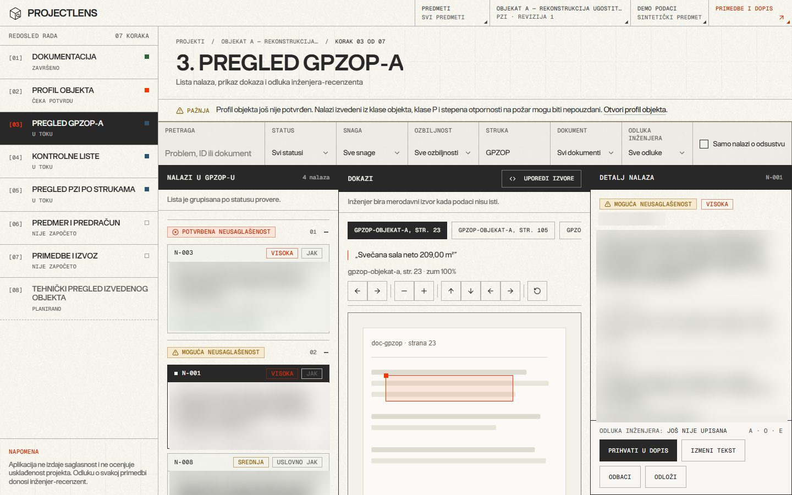

**Result so far:** on real projects, one fire-protection review that used to take the engineer about 15 hours now takes about 20 minutes, with the engineer still reading and signing off every objection.

---

## Gallery

All screenshots use the app's built-in fictional demo data ("Objekat A/B/C"). Objection texts and rule references are blurred on purpose.

| | |
|---|---|
| 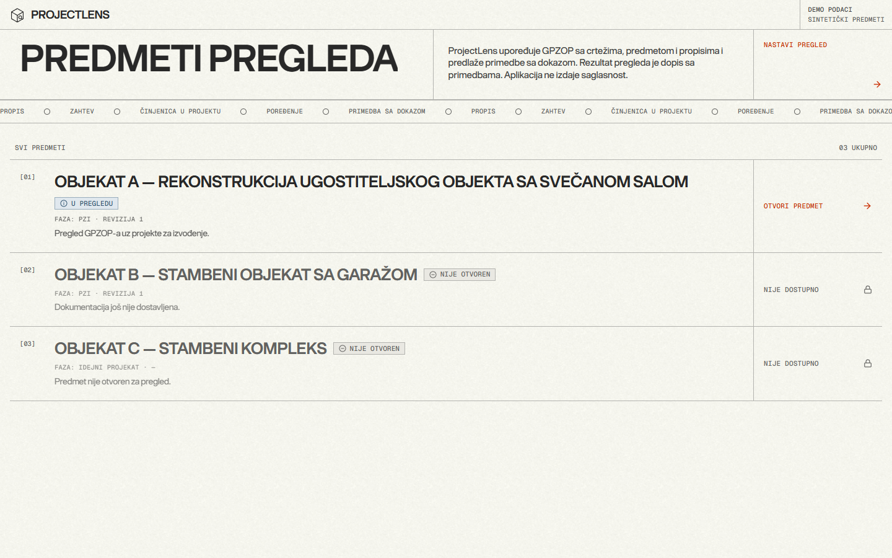 Cases | 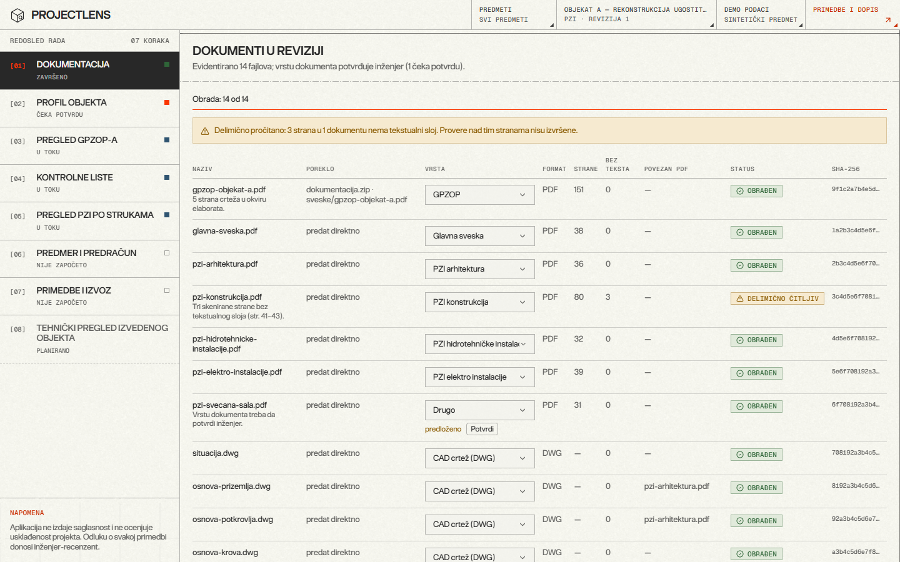 Document intake, one revision |
| 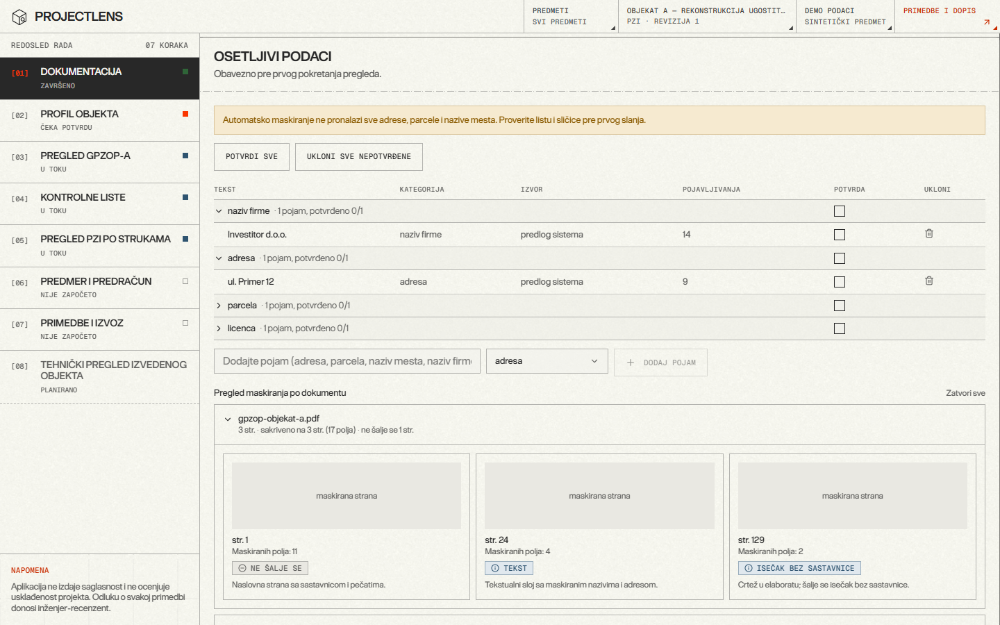 Masking review before any model call | 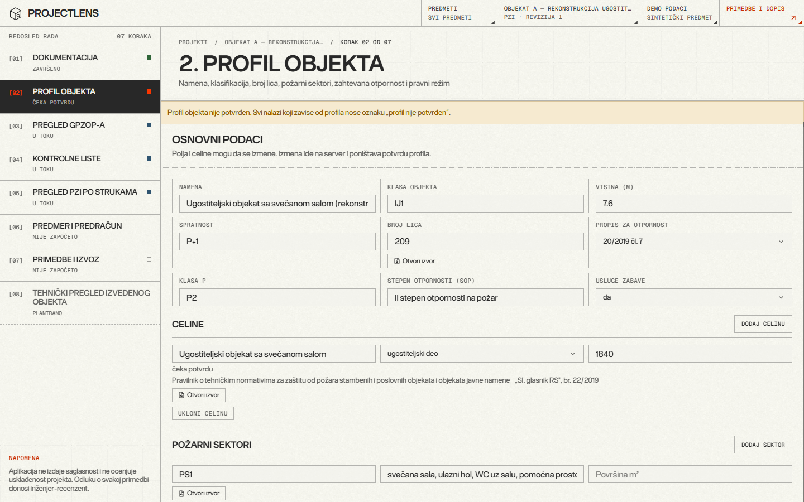 Building profile the rules depend on |
|  GPZOP review: findings, evidence, decision | 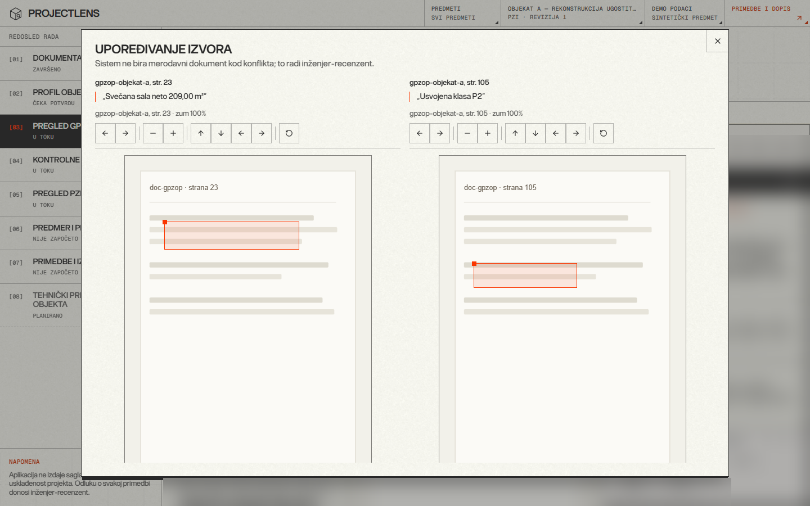 Two sources side by side when they disagree |
| 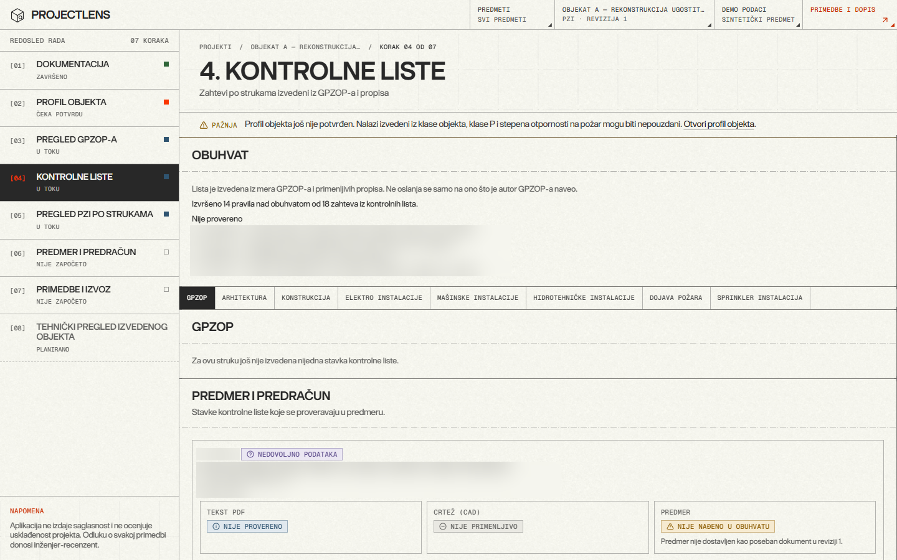 Checklists per discipline with explicit scope | 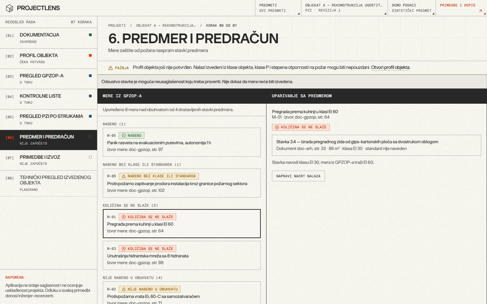 Fire measures vs bill of quantities |
| 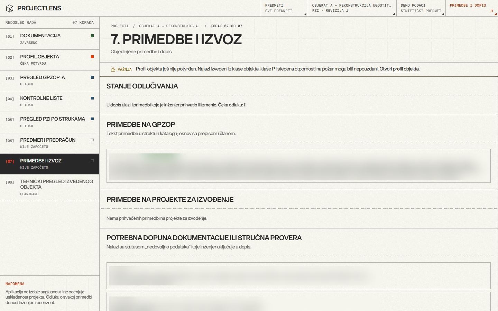 Accepted objections and export | 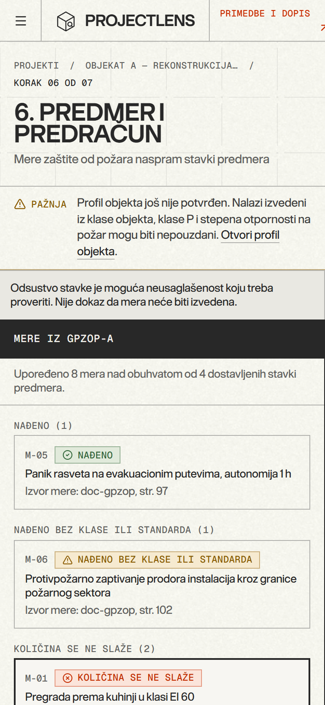 Phone layout (375 px) |

## The problem

In Serbia, a building's fire-protection design is checked against laws, rulebooks and referenced standards before a permit is granted. The reviewer's output is a letter of objections, and each objection has to cite an article. Doing this by hand means:

- reading hundreds to thousands of pages: the GPZOP, every discipline's design, the bill of quantities, plus DWG and DWFx drawings;
- checking that a measure promised in the GPZOP actually appears on the drawings and in the bill of quantities;
- working out which rules apply, which depends on building use, size and the date of the permit.

Most real errors are not subtle. They are inconsistencies between documents, missing bill-of-quantities items, outdated classifications and wrong legal references. Each one that slips through costs the investor another review round.

## How it works

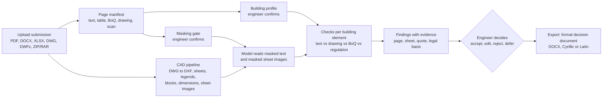

1. **Intake.** A whole submission goes in at once, archives included. Every page is classified and every file keeps its origin.
2. **Profile.** The facts that decide which rules apply (use, height, occupancy, fire sectors) are extracted and confirmed by the engineer. Findings that depend on an unconfirmed profile are flagged.
3. **Masking.** Names, addresses, parcel numbers, licences and stamps are blacked out before any external call, and the engineer must confirm the masking first. The API refuses the call until then.
4. **Review.** For each building element, the tool compares what the GPZOP says with the discipline volumes, the drawings, the bill of quantities and the regulation. The model extracts facts and points at things on drawings; code does the counting, measuring and comparing.
5. **Decision and export.** Only objections the engineer accepted or edited go into the exported document.

## What changed since the hackathon

- **Drawings are read as images.** Drawing sheets (from DWG, DWFx, or drawing pages inside PDFs) are rendered and sent to the model after masking. The model says what a sheet is and points at locations; code counts symbols and measures from the vector geometry. A PDF drawing page is only used to find the same sheet in the DWG/DWFx, so measurements come from the vector file.
- **Fast DWG processing.** Reading a 20 MB DWG (161 MB once converted to DXF) went from about 33 minutes to about 3 minutes with identical output, by measuring each block once instead of once per insert and reading texts once. Several drawings that used to fail on intake now convert and read.
- **Accuracy is measured, not guessed.** A built-in evaluator compares a review against the objections the engineer wrote by hand on the same project, explains every miss by cause (element not reviewed, page not sent, comparison found nothing, and so on), and reports precision from the engineer's decisions and repeatability between two runs. On two real, anonymized submissions, all 13 hand-written objections were matched to a finding, either as the same defect or as a related finding on the same topic. Precision is the next number to collect, once the engineer has decided on enough findings.
- **Unsent-pages report.** Every page that does not go to the model gets a reason (scan, Cyrillic not yet confirmed, residue after masking, too little text). That report showed that most unread content sat on drawing sheets inside PDFs, which led directly to the drawings-as-images work.
- **Masking got stricter and faster.** Extra masking passes for leftovers, rotated words masked whole, per-case confirmation for Cyrillic. Pages made of thousands of tiny image tiles are masked in chunks, which in local tests cut the pre-model processing of a large project from about 32 to about 5 minutes (change currently in review).
- **Export in the engineer's own format.** The export produces the formal decision document the engineer actually issues, in Cyrillic or Latin script, with the legal basis copied from the catalog.
- **New frontend.** A redesign of every screen around one workspace: findings, evidence and detail side by side, a sticky decision bar and keyboard shortcuts for accept, reject and edit.

## Stack

| Layer | Technology |
|---|---|
| Frontend | TanStack Start, React 19, TypeScript, Tailwind 4, shadcn/ui, TanStack Query, GSAP; typed data layer that runs on demo data or the live API |
| Backend | Python, FastAPI, PostgreSQL 16 (Docker), SQL migrations, background worker, pytest (800+ tests) |
| Documents | PyMuPDF, pdfplumber, python-docx, OCR for scans; ZIP/RAR intake |
| CAD | ODA File Converter + ezdxf for DWG, own DWFx reader, sheet rendering, legend and block interpretation |
| AI | Provider-agnostic adapter with a model per step (Anthropic Claude for judgment, a cheaper model for reading), structured outputs, prompt caching, per-project budget, every call logged by hash |
| Contract | `schema.sql` + OpenAPI generated from the frontend types; architecture decisions recorded as ADRs |
| Workflow | Two developers plus coding agents, mandatory cross-review, no self-merge, automated privacy check over hashes |

## Engineering highlights

- **The code judges, the model reads.** The model extracts facts into a closed schema and points at things; deterministic code produces the findings. "Not enough data" is a valid result and is never turned into "compliant".
- **Legal basis is copied, never generated.** Every objection takes its legal reference from a verified catalog. A finding without one is downgraded.
- **Privacy is enforced in code.** One function is the only path to an external model. It checks the masking confirmation, rejects any request that still contains a term from the project's sensitive-terms list, enforces the budget and writes the call log.
- **Cost is known before a run.** The tool estimates calls, cost and time before a review starts, reuses work between document revisions and refuses to start when the estimate is over budget.
- **Performance work is measured on real data.** Each optimization comes with a before/after timing on a real project and a check that the output hash did not change.
- **Tests that prove they test something.** For the larger changes, each fix is reverted on purpose to confirm a test fails without it.

## Status (end of October 2026)

| Area | State |
|---|---|
| Intake, page manifest, masking gate, building profile | working |
| CAD: DWG/DWFx sheets, sheet images, legends, symbols, dimensions | working, being extended (rooms and evacuation routes) |
| Review per building element, checklists, bill-of-quantities matching | working |
| Accuracy evaluation (recall, miss causes, precision, repeatability) | working; recall measured on real projects |
| Export in the engineer's decision format | working |
| Agentic review that follows the engineer's own step-by-step procedure | in progress |
| Deployment | runs locally; next step is a one-command start on the engineer's own machine |

Next: extend the same approach to other engineering disciplines beyond fire protection.

## Why the code is private

- **Domain knowledge is the product.** The rules, checklists and reference material come from years of a practicing reviewer's work and are not ours to publish.
- **Client confidentiality.** Development uses real submissions, which must never appear in a public repository or its history.
- **Licensed standards.** Some referenced standards cannot be redistributed.

I'm happy to walk through the code and architecture in an interview.

## Team

- **Sergej Stojanović** ([@Excapex](https://github.com/Excapex)): architecture and ADRs, backend (intake, manifest, masking, model adapter, CAD pipeline, review engine, accuracy evaluation, export), performance work, and the review and privacy automation.
- A second developer: frontend screens, archive intake, masking review, checklists and parts of the export.
- Domain expertise from a licensed fire-protection engineer.

## Contact

LinkedIn: [linkedin.com/in/sergej-stojanovic-dev](https://www.linkedin.com/in/sergej-stojanovic-dev/)

## Disclaimer

ProjectLens does not issue fire-protection consent and does not replace a licensed designer, reviewer or the competent authority.
