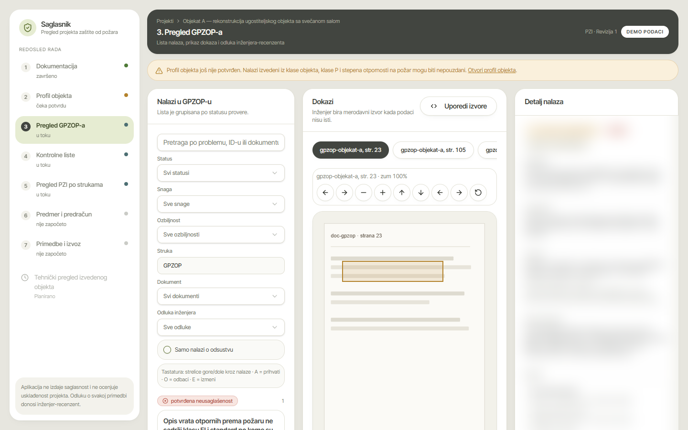
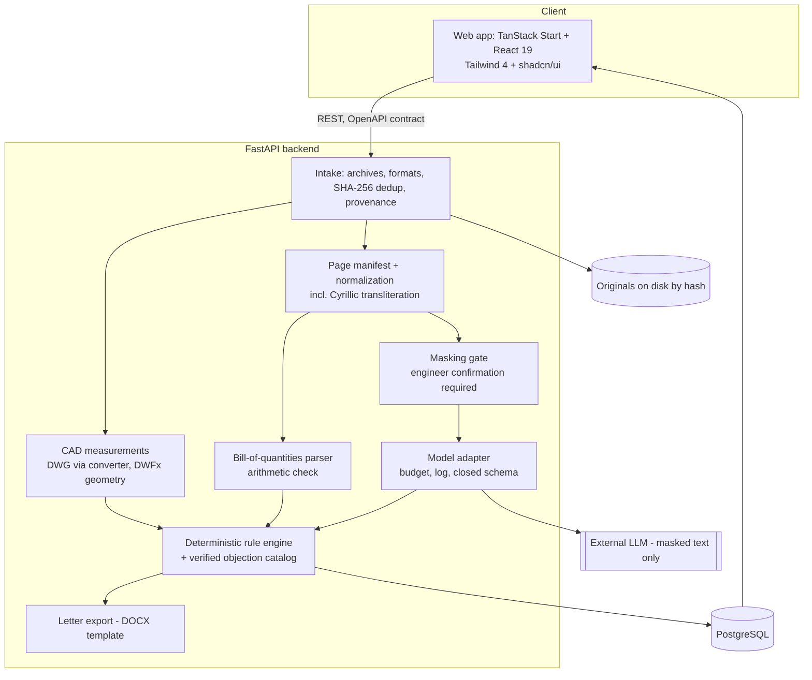
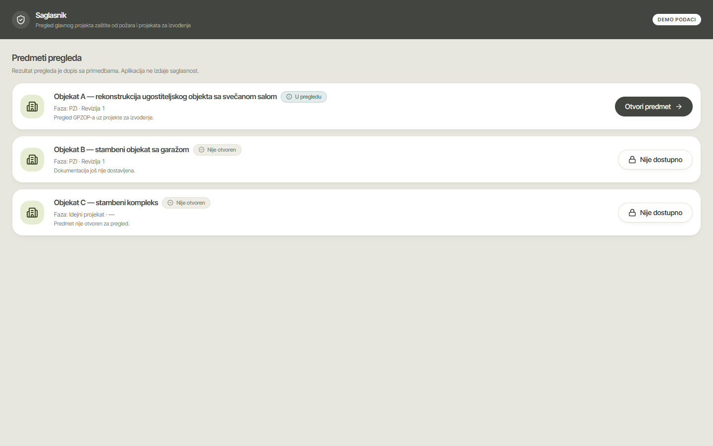
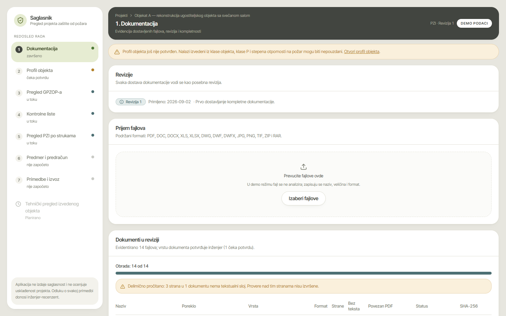
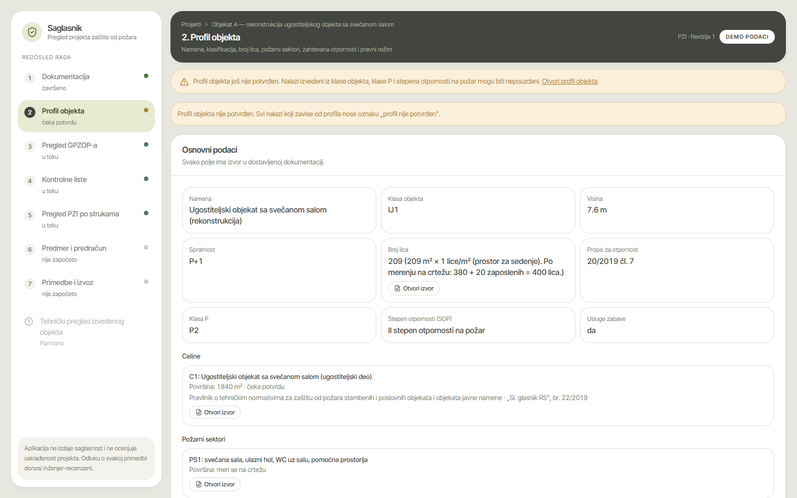
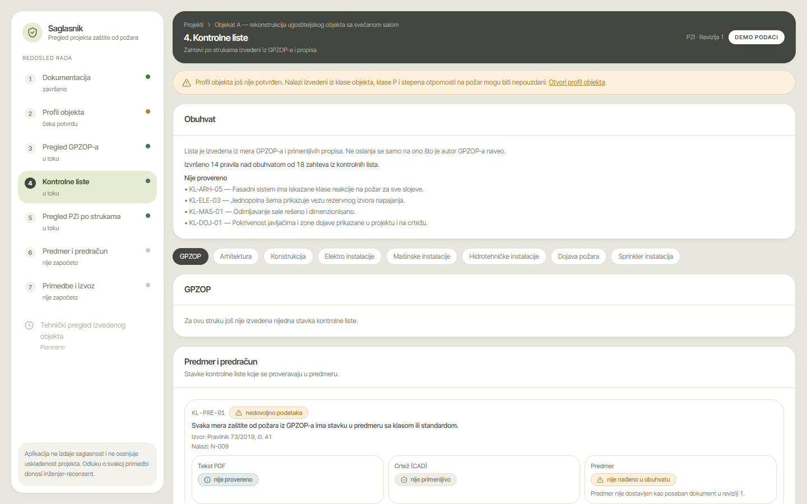
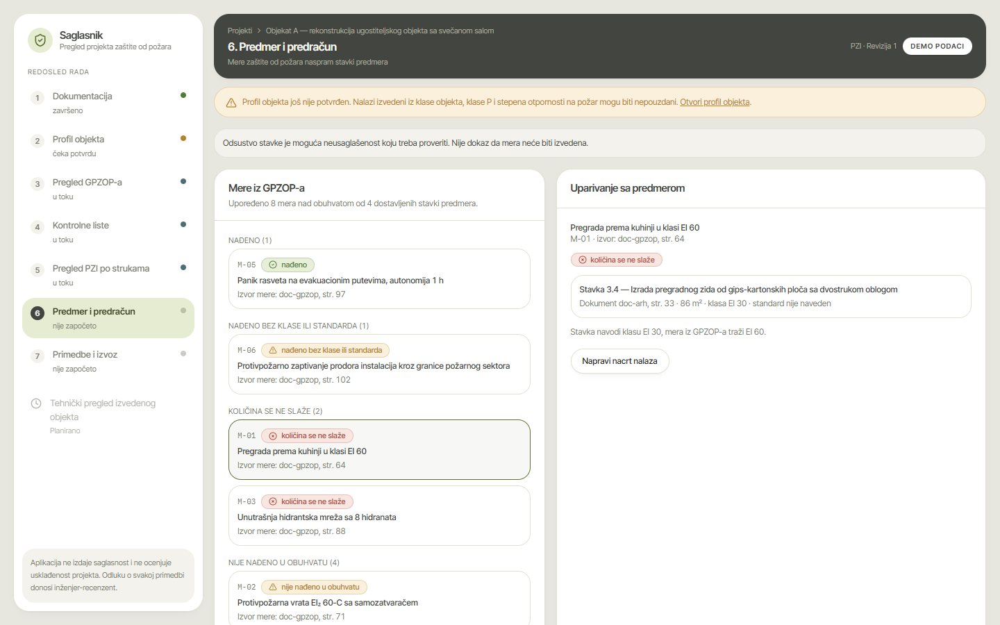
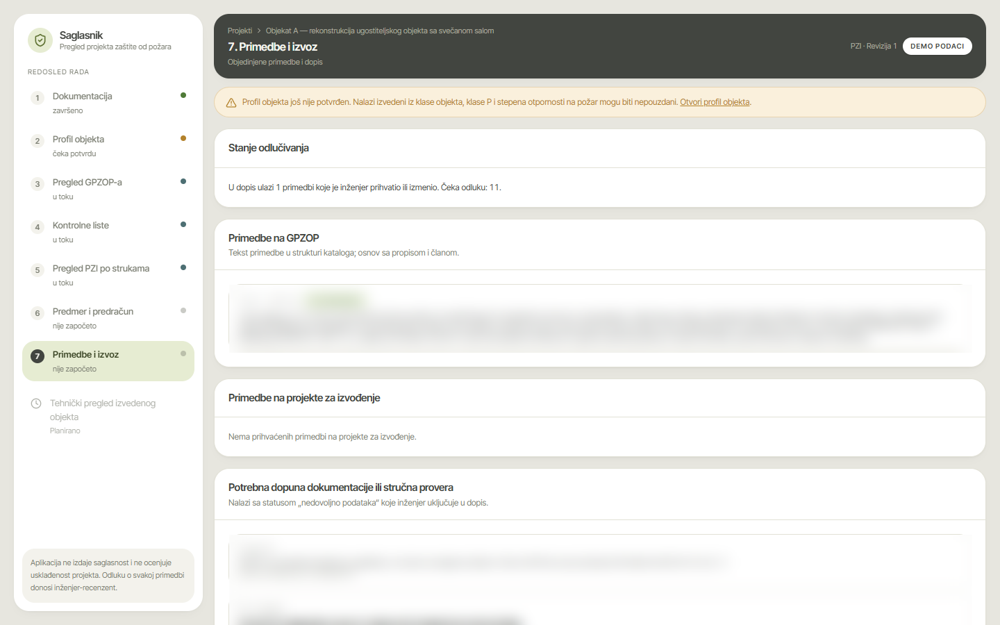

# Saglasnik — review copilot for fire-protection documentation

> Saglasnik helps a fire-protection engineer review the main fire-protection design (GPZOP) together with the construction documents of the other disciplines, including the bill of quantities and CAD drawings. It drafts **objections with a legal basis and page-level evidence**. The engineer decides on every one.
>
> This is a **showcase repository**. The product code is private while it is being developed.

**Status:** active development, private beta with a domain expert. **Origin:** grew out of [ProjectLens](https://github.com/Excapex/GROKHakaton), built in one day at the Grok Bot Serbia Hackathon (Belgrade, 12.09.2026).

---

## Problem

Before a building in Serbia can be built or used, its fire-protection design is checked against a large body of regulations: laws, rulebooks and referenced standards. The reviewer's output is a letter of objections, each one citing an article. Today the reviewer builds that letter by hand:

- reading hundreds to thousands of pages across the GPZOP, the construction documents of each discipline, the bill of quantities and the DWG/DWFx drawings;
- cross-checking that a measure required in the GPZOP actually appears in the drawings and in the bill of quantities;
- working out which regime applies. The applicable rules depend on building use, category and the date of the permit.

The recurring errors are rarely subtle. They are inconsistencies between documents, requirements missing from the bill of quantities, outdated classifications and wrong legal references. Each one that slips through costs the investor another review round.

## Solution

Saglasnik works through the review in the same order a reviewer does:

1. **Documentation.** Upload a whole submission, including ZIP/RAR archives, with provenance tracked for each file. Every page is classified (text, table, BoQ, drawing, scan) and normalized, including Cyrillic.
2. **Building profile.** Extract the facts that decide which rules apply and let the engineer confirm them. Rules that depend on an unconfirmed profile are flagged as unreliable.
3. **GPZOP review.** A findings list, the evidence viewer with the page, and a side panel with the problem, consequence, requirement, legal basis and calculation.
4. **Checklists per discipline**, each with an explicit search scope.
5. **Bill of quantities.** Measures required by the GPZOP are matched against BoQ items, with an arithmetic check (quantity × price = amount).
6. **Objections and export.** Only findings the engineer accepted or edited go into the letter, which is exported to DOCX from a template.

What makes it different:

- **The code judges, not the model.** The model only extracts facts into a closed schema, and deterministic rules produce the findings. "I don't know" is a valid answer, so it never gets turned into "compliant".
- **The legal basis is copied, never generated.** Every objection carries its reference from a verified catalog. A finding without a basis is downgraded to "insufficient data".
- **Privacy by default.** Project names, addresses, tax IDs, licences and stamps are masked before any external model call, and an engineer must confirm the masking first. The API refuses the call until then. Every outbound call is logged by hash.
- **No approval.** The tool never issues consent and never states that a project is compliant.

## Architecture

## Stack

| Layer | Technology |
|---|---|
| Frontend | TanStack Start, React 19, TypeScript, Tailwind 4, shadcn/ui, TanStack Query; typed data-source layer (mock or HTTP) |
| Backend | Python, FastAPI, PostgreSQL 16 (Docker), SQL migrations, pytest (~160 tests) |
| Documents | PyMuPDF, pdfplumber, python-docx; ZIP/RAR extraction; DWG/DWFx processing |
| AI | Provider-agnostic model adapter with per-project budget and call log; xAI Grok primary, other models for comparison |
| Contract | `schema.sql` + OpenAPI generated from the frontend types; five accepted ADRs |
| Workflow | GitHub Actions CI (ruff, pytest, tsc, build), a privacy check over hashes, a merge guard that needs green CI and approval from a non-author, and agent skills for orchestration and review |

## Highlights

- **Research before code.** A feasibility phase (F0) measured each risky step on real, anonymized submissions before any production code was written: page classification, BoQ parsing, DWFx scale, masking recall and SOP class derivation.
- **Evaluation against reality.** A reference set of expert objections and official rejection decisions from the authority, paired where possible with the corrected resubmission. The pairs showed, for example, that an "addressed" label in a document is not proof that the problem was fixed.
- **Catalog quality.** The objection catalog has a structured legal basis per item, and most citations have been checked against the regulation text. The checked subset contained no errors.
- **Engineering process for two developers and their agents.** Locked contracts (ADRs), small PRs, mandatory cross-review, no self-merge, and an automated privacy check that has already caught two leaks.

## Screenshots

All screenshots use **fictional demo data** ("Objekat A/B/C"). No client documents are shown.

| | |
|---|---|
|  Projects |  Case overview |
|  Documentation intake |  Building profile |
|  GPZOP review with evidence |  Checklists by discipline |
|  Bill of quantities vs GPZOP |  Objections and export |

## Status (end of September 2026)

| Area | State |
|---|---|
| Research and plan | done |
| Data model, API contract, rule format, model and masking policy, CAD approach | locked (ADR 001–005) |
| Intake, archives, page manifest, normalization, page images | implemented |
| Masking with confirmation gate | implemented |
| Building profile, first rules, checklists, BoQ parser, CAD measurements | implemented, being extended |
| Review pipeline, completeness checks, DOCX letter export | implemented, being extended |
| Frontend | all screens built, being moved from demo data to the live API |
| Deployment | local only for now; hosting to be decided after the pilot |

## Why the code is private

- **Domain knowledge is the product.** The catalog, the rules and the reference set come from years of a practicing reviewer's work. They were shared for building this tool and are not ours to publish.
- **Client confidentiality.** Development relies on real submissions, which can never appear in a public repository, not even in Git history.
- **Licensed standards.** Some of the referenced standards cannot be redistributed.
- **Early stage.** The rules are still being validated with a licensed engineer.

I'm happy to walk through the code and the architecture in an interview.

## Team

- **Sergej Stojanović** ([@Excapex](https://github.com/Excapex)): research and planning, architecture and ADRs, backend (intake, manifest, normalization, masking, model adapter, BoQ parser, CAD measurements, review pipeline), CI and the privacy and merge automation.
- A second developer: frontend, archive extraction, masking review gate, rules and completeness checks, DOCX letter export.
- Domain expertise from a licensed fire-protection engineer.

## Disclaimer

Saglasnik does not issue fire-protection consent and does not replace a licensed designer, reviewer or the competent authority.
